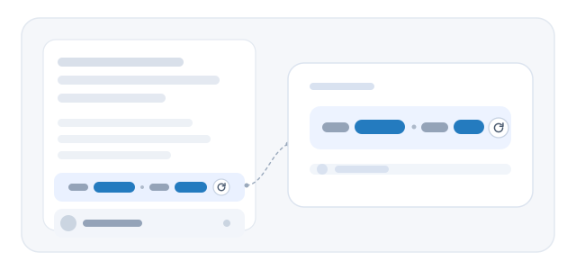

# dsh-account-balance-pill

[English](README.md) | [中文](README.zh.md)

A DeepSeek Harness (DSH) plugin that shows the signed-in account's **top-up balance** and **bonus balance** in one line above the sidebar account entry. It refreshes every minute and has a refresh button.



*Illustration of the row: top-up and bonus amounts with a refresh button, directly above the avatar row.*

## Features

- Always shows both amounts: top-up balance and bonus balance, formatted like the Platform balance card (two decimals, digit grouping, `<¥0.01` for positive sub-cent amounts).
- Refreshes automatically every 60 seconds and pauses while the page is hidden; when the page or window returns after more than 10 seconds, it reads again.
- A refresh button on the right starts a read immediately and restarts the one-minute timer.
- When a read fails, the last successful amounts stay visible with a warning mark and an amber refresh button; the tooltip and a screen-reader status message explain the failure.
- Hidden when no account credential is stored (for example an API-key-only setup) and in the collapsed icon rail.
- Uses the theme's `--dsw-alias-*` tokens, so it follows light and dark themes.

## Install

The Desktop app uses the `desktop` profile; `dsh web` uses `web`. Replace `desktop` with your profile name if needed.

From GitHub:

```sh
dsh plugin --profile desktop add github:cheny5100/dsh-account-balance-pill
```

From npm (after the package is published):

```sh
dsh plugin --profile desktop add dsh-account-balance-pill
```

From a local directory:

```sh
dsh plugin --profile desktop add D:\path\to\dsh-account-balance-pill
```

Confirm the row in **Plugins**, then refresh the page. The browser module is served by the Host after the bundle row is enabled.

## Usage

- Sign in to your DeepSeek account. The row appears in the sidebar foot, directly above the account entry, left-aligned with the account row.
- The row reads `Top-up ¥12.34 · Bonus ¥5.00` with a refresh button. Hover it for the full amounts, the last update time and any failure reason.
- Click the refresh button to read immediately. The button spins while a read is in flight.
- Collapsing the sidebar to the icon rail hides the row.

## Behavior

| Situation | What the row does |
|---|---|
| Signed out / API-key-only | Hidden |
| Loading | Shows `—` for both amounts |
| Success | Shows both amounts; refresh every 60 s |
| Failure after a success | Keeps the last amounts, shows a warning mark, turns the refresh button amber and reports the failure to assistive technology |
| Failure before any success | Shows the localized "balance unavailable" text and the refresh button |
| Page hidden | Pauses requests; reads on return when the last read is older than 10 s |
| Repeated failures | Backs off 60 s → 120 s → 240 s → 300 s, reset by a success or a manual refresh |

There are no configuration options.

## Compatibility

- DSH `>=0.2.2-rc.3 <0.3.0`, Desktop and Web clients (`platform: web`).
- No runtime dependencies and no build step; the browser bundle is plain JavaScript.

## How it works

- The Host row is an empty `apply()`; its only job is to enable the package so DSH's client module system scans and serves `./client`.
- The browser module registers into the `sidebar.footer.action` list slot and calls the existing account Remote, `ctx.remote.account.getBalance(metadata)`, with the client version, active language and UTC offset.
- The Host asks the configured `platformOrigin` for the signed-in account's wallet summary. The account token stays on the Host; the browser only receives currency codes and decimal amount strings.
- Amounts keep the server's decimal precision until display; the formatting follows the Platform card rules.

## Limitations

- Only DeepSeek account sign-in produces a balance. A profile that uses only an API key has no account entry and no balance row.
- The row is not rendered in the collapsed icon rail (56 px), where labels do not fit.
- DSH currently has no extension point inside the account row itself, so the row sits directly above it.
- When the shipped dynamic-Cordis footer action is visible (it appears only while dynamic Cordis plugins exist), both actions share the single sidebar-foot row and the balance row can be squeezed. This is a limitation of the shipping footer layout; profiles without dynamic Cordis plugins are unaffected.

## Development

Edit `client.js`; there is no build step. Reinstall the bundle or reload the plugin, then refresh the page.

## License

[MIT](LICENSE)
